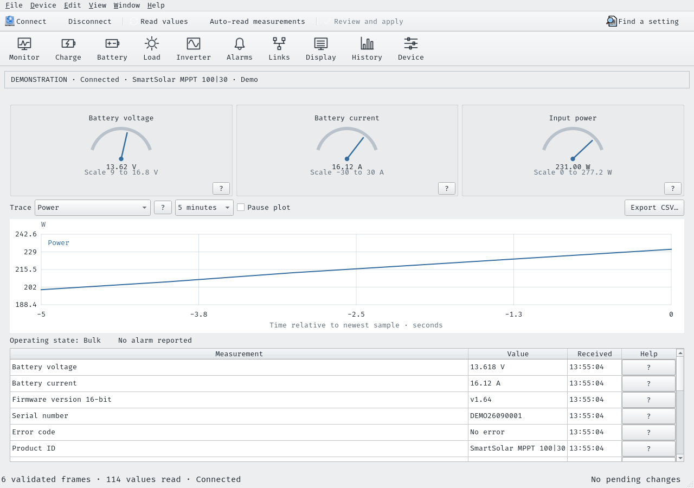

# VeDirWiz

A native Qt desktop application for configuring and monitoring Victron
VE.Direct devices, built on the sibling [ve.direct](../ve.direct) library.
The application uses Qt Widgets through PySide6. It does not run a website,
HTTP server, or GTK interface.



[View the separate charging window](docs/screenshots/charging.png).

## Run

On this NixOS workspace:

```sh
cd ~/Documents/GitHub/VeDirWiz
nix-shell --run 'python3 run.py --demo'
```

For a physical device:

```sh
nix-shell --run 'python3 run.py --port /dev/ttyUSB0 --family MPPT'
```

Running `python3 run.py` starts disconnected. The Connect dialog lists serial
ports and supports a manually entered port. The application reads settings
after connection. It does not write anything until Apply.

On other systems with Python 3.10 or newer:

```sh
python3 -m venv .venv
. .venv/bin/activate
python -m pip install -e '../ve.direct[serial]'
python -m pip install -e '.[serial]'
vedirwiz --demo
```

On Windows, activate the environment with `.venv\Scripts\activate` and use
a port such as `COM3`. Qt supports Windows, Linux, and macOS; this checkout
has been tested on Linux with Qt's offscreen platform.

The library loader first checks `../ve.direct/src`, then an installed
`ve_direct` package. Set `VE_DIRECT_SOURCE` to use another checkout:

```sh
VE_DIRECT_SOURCE=/path/to/ve.direct python3 run.py --demo
```

## The application

- The main window stays on live monitoring. A top icon toolbar opens separate
  Charging, Battery monitor, Load & lighting, Inverter, Alarms & relays,
  Connections, Display, History, and Device windows. Short labels accompany
  every icon; the Window menu also lists every section. Several windows can
  stay open together. Opening a section again raises its existing window.
- A native menu bar and command toolbar with Connect, Read values,
  automatic measurement reads, and Apply. File and Device menus include
  settings import/export and Read all. Ctrl+F opens a separate setting-search
  window. Named section tabs keep related controls together within each window.
- Friendly setting names, units, enum choices, switches, and named flags.
  The interface does not require entering register addresses or payloads.
  Aliases resolve to the selected family's actual definition before display.
- Question-mark buttons open full authored explanations in a resizable,
  dockable help panel in the setting's own window. Help covers purpose, effects, dependencies,
  write-only limitations, and official protocol references.
- Draggable charge-stage, temperature-compensation, night-lighting, and
  Peukert model editors. Numeric fields provide exact and keyboard-accessible
  equivalents. On a curve, Left/Right selects a point and Up/Down adjusts it;
  Ctrl+Left/Right adjusts lighting-event timing.
- Live analog meters, selectable telemetry traces, pause, CSV export,
  numeric readout sparklines, daily yield and charge-cycle plots, and an
  activity dock. Measurement ranges are display scales, not safety ratings.
- Clear connected, demonstration, stale-data, unsupported, and fault states.
  Values from alternating Text frames are retained with their timestamps.
- Settings profiles import as pending edits. They exclude one-time commands
  and transient external-controller inputs. Full JSON snapshots include
  history, read results, telemetry, timestamps, and the activity log.
- Light and dark themes, keyboard shortcuts, native file dialogs, pending
  edit undo/redo, remembered configuration-window sizes and positions,
  and remembered monitoring-window dock layout.
- Factory reset, resettable-history clearing, BMV synchronization,
  zero-current calibration, alarm acknowledgement, manual charger commands,
  and Phoenix settings-memory commands, where the library exposes them.

## Apply behavior

Edits remain in the application until **Review and apply**. All windows share
one device connection and one set of pending edits. Closing a configuration
window preserves its drafts; opening it again restores them. Apply reviews
pending changes from every window together. Device reads preserve those
changes. Discard restores displayed device values without sending a write.
Closing the whole application requires a decision about pending edits.

Apply validates types, resolution, known device limits, and related
voltage boundaries. It checks readable settings for external changes before
writing, then sends changes sequentially. Ordinary settings get a readback
check. Write-only targets receive explicit command-accepted status.
Normal Phoenix Apply also sends its required nonvolatile-memory Save.

The protocol has no atomic multi-setting transaction. A failure stops the
batch, identifies accepted/verified/failed/unattempted settings, and preserves
remaining edits. Earlier accepted changes can already affect the device.
It does not attempt an automatic rollback of power-control settings.

Maintenance commands are staged separately. Their review includes the full
explanation and an acknowledgement checkbox. A battery preset must also be
applied separately because the device can change other targets internally.
Presets and maintenance invalidate cached settings and require a fresh read.

After a communication timeout, the underlying library blocks further HEX
commands to avoid treating a late reply as a new response. The UI reports the
fault. Reset and drain the physical link as described by ve.direct, then
disconnect and reconnect. It does not automatically resume uncertain writes.

## Device coverage

| Family | Devices | Distinct catalog entries | Writable controls |
| --- | --- | ---: | ---: |
| MPPT | BlueSolar / SmartSolar, rotary-switch preset table | 188 | 79 |
| MPPT_SMALL | 10 / 15 / 20 A models, small-model preset table | 188 | 79 |
| MPPT_RS | Solar RS | 217 | 82 |
| ORION | Orion XS DC-DC | 132 | 53 |
| BMV | BMV battery monitors | 125 | 83 |
| BMV71 | BMV-712 / compatible SmartShunt | 125 | 83 |
| INV | Phoenix inverters | 60 | 31 |
| CHG | Shared charger controls | 60 | 38 |
| MULTI_RS | Multi RS, includes experimental definitions | 259 | 99 |

A catalog entry does not guarantee support on every model or firmware.
Rejected reads remain visible as unavailable. Standalone SmartSolar firmware
1.64 reports unused network charge inputs as Unavailable rather than as
maximum wire integers, and display scroll speed 3 is a valid intermediate
choice. The selected family is explicit; product identification alone does
not reliably determine all preset variants.

Phoenix's public HEX reference lists dynamic-cutoff coefficients without
their curve equation. The app graphs **measured cutoff against measured AC
current** and explains the coefficients. It does not invent a voltage curve.
Automatic measurement reads can collect more points while varying real loads.

The demo exchanges real checksum-valid Text and HEX frames through ve.direct.
Its values illustrate configuration and are not a battery or charger physics
model. Firmware flashing and bootloader entry are not implemented.

## Checks

```sh
nix-shell --run 'QT_QPA_PLATFORM=offscreen python3 -m unittest discover -s tests -v'
```

Tests cover catalog/help completeness, family resolution, validation,
profile round trips, external-change detection, partial Apply failures,
Phoenix save behavior, all demo families, and native-widget editing/search/
keyboard curve controls, reusable independent windows, local help, shared Apply,
and rebuilding open windows when the device family changes.
No physical VE.Direct device was used for testing.

See [design notes](docs/DESIGN.md) for the desktop UI references and decisions.
The application and its ve.direct dependency use AGPL-3.0-only.
